# TrustGate

**Your AI agent broke after five feature flags changed. Rolling everything back would throw away
the improvements that still work. TrustGate finds what broke, tests a targeted repair, and asks
for your approval before changing a single production flag.**

Built for [Toggle Wars](https://www.wemakedevs.org/hackathons/flagsmith), Track 2: AI Agents and
Feature Flags.

> Demo video: _coming Saturday_ · Status: in development

## How it works

```mermaid
flowchart LR
    subgraph prod["Your AI agents (OpsPilot, VaultGuard)"]
        AG["Agent"]
    end
    FS[("Flagsmith")]
    AG -- "flags per request<br/>(SDK, server-side key)" --> FS
    AG -- "failure" --> INC["Incident capture<br/>(flags it received, traits, DB, trace)"]
    INC --> ORCH["Orchestrator"]
    ORCH --> INV["Investigator (LLM)<br/>no Flagsmith key"]
    INV -- "allowlisted reads" --> GATE
    ORCH --> SB["Sandbox replays<br/>captured config + overrides"]
    SB --> GR["Deterministic grader<br/>(database, not the agent's word)"]
    GR --> SEARCH["Delta debugging<br/>+ repair validation"]
    SEARCH --> PROP["Proposal<br/>(write built by code)"]
    PROP --> UI["Web UI"]
    UI -- "human approves" --> API["API signs a<br/>single-use approval"]
    API --> GATE["Gate<br/>(only holder of the org key)"]
    GATE -- "one approved write (MCP)" --> FS
    GATE --> VER["Verifier read-back"]
    VER -- "server-side key" --> FS
    CC["Claude Code / Cursor"] -- "MCP, no write tools" --> MCPS["TrustGate MCP server"]
    MCPS --> API
```



1. A Flagsmith release changes several flags that control an AI agent (model, prompt, tools).
2. The agent misbehaves. TrustGate captures exactly what the failing agent received.
3. It replays the agent in a sandbox and uses delta debugging to find a minimal set of flag
   changes that reproduces the failure.
4. It tests repairs, narrowest first, and proposes the smallest one that passes: usually a
   segment override that protects only high-risk users.
5. A human approves the exact change. Only then does TrustGate write to Flagsmith, read the
   result back, and re-run the incident.

## How we use Flagsmith

Flagsmith is the system TrustGate investigates and repairs. Without it there is nothing to
diagnose and no way to apply a fix.

**Flags drive the agents.** OpsPilot and VaultGuard read their model, prompt version, tool
policy, step limit and context mode from Flagsmith per request, with trusted traits (`env`,
`tier`, `amount_usd`, `new_vendor`) set in code. Each incident records the flag values the
failing agent actually received. *(in progress in `sandbox/`)*

**Snapshots and the release diff.** `scripts/release.py` plays the team shipping a release.
Before and after, it saves:
- the **edge environment document** (what the SDK evaluates; current right after a write)
- the **Admin API environment document** (typed values: the edge returns integers as strings,
  e.g. `"6"`)

The diff between the two snapshots is the suspect list. The audit log is never parsed for
values.

**Fingerprint and the stale check.** The gate fingerprints an environment as a SHA-256 over
its feature states, segment rules and segment overrides from the edge document (ids and
timestamps dropped). We use the edge document because the Admin API document (the one the
Flagsmith CLI reads) kept serving the old state for 26–68 s after a write in our tests. Every
proposal is registered with the gate at its fingerprint. A write is refused (409) if
Flagsmith has changed since.

**MCP for reads.** The gate talks to the hosted Flagsmith MCP server
(`https://mcp.flagsmith.com/mcp`), which exposes 54 tools. The investigator can use 8 of
them, by exact name, plus two reads the gate serves itself:
- `get_environment_document`: the canonical edge document
- `get_audit_log`: the gate's own trail

Organisation listings, code references and every other tool are refused. Reads must name our
project or environment.

**MCP for the one write, via v2 feature versioning.** Every environment in our organisation,
including ones we created, came up with v2 feature versioning on, and v2 can't be switched
off. The legacy write tools (`create_segment_override`, `update_feature_state`,
`delete_feature_segment`) only work without v2. So every approved change is one
`create_environment_feature_version` call per feature, with `publish_immediately: true`:
- `feature_states_to_create`: add a segment override
- `feature_states_to_update`: change the environment default
- `segment_ids_to_delete_overrides`: remove an override

The version's description carries the proposal and approval ids.

**Verification.** After a write, the verifier resolves a tier-0 identity and a staging
identity through the edge identities endpoint (server-side key, transient identity) and
polls for up to 60 s. Values from a default handler never count.

**Audit trail.** On our plan, Flagsmith's audit endpoint returned HTTP 500 or no entries, and
v2 versions record no author for API-key writes. So the gate keeps its own append-only,
hash-chained JSONL trail: who approved, the payload hash, the fingerprints before and after,
and the result. We match Flagsmith's version history (`get_environment_feature_versions`) by
version uuid to get "when".

## Quickstart

Requires Docker, or Python 3.12+ with [uv](https://docs.astral.sh/uv/) and Node 22+.

```bash
cp .env.example .env            # set APPROVER_PASSWORD at least; MOCK=1 serves demo data
cp .env.gate.example .env.gate  # the Flagsmith organisation key goes here, nowhere else
docker compose up --build
```

Open http://localhost:3000. Expected: an investigations list with an OpsPilot incident waiting
for approval. With `MOCK=1` every number on screen is fixture data.

Port 3000 already taken? Pick another host port and tell the API about it:
`WEB_PORT=3001 WEB_ORIGIN=http://localhost:3001 docker compose up --build`.

Without Docker (works the same in PowerShell, bash and zsh):

```bash
cp .env.example .env    # set APPROVER_PASSWORD; MOCK=1 is already set
uv sync
uv run uvicorn api.main:app --env-file .env --port 8000
```

`--env-file .env` matters: the API reads settings only from its environment, so without it
login stays disabled. In a second terminal, start the UI:

```bash
cd web
npm ci
npm run dev
```

Check it end to end with the smoke test, which signs in, approves the demo proposal and waits
for Verified. It reads the password from your shell, not from `.env`:

```bash
# PowerShell: $env:APPROVER_PASSWORD = "<the password in .env>"
# bash/zsh:   export APPROVER_PASSWORD="<the password in .env>"
uv run python -m scripts.smoke     # expect: SMOKE PASSED
```

With `MOCK=1` the gate isn't needed. With real Flagsmith keys, run it too (third terminal):
`uv run uvicorn gate.service:app --env-file .env.gate --port 8100`.

### Real mode with Ollama (the end-to-end setup)

1. Install [Ollama](https://ollama.com) and pull the two models: `ollama pull qwen3:14b` and
   `ollama pull qwen3:8b` (about 15 GB together).
2. Write `.env` and `.env.gate` with the setup script. It asks for the Flagsmith keys (typed
   hidden) and offers the Ollama defaults: `bash scripts/setup_env.sh` on macOS/Linux, or
   `powershell -ExecutionPolicy Bypass -File scripts\setup_env.ps1` on Windows.
3. `docker compose up --build`, then open http://localhost:3000. The api container reaches
   Ollama on the host at `host.docker.internal:11434`.
4. Play a release (it reads the keys from `.env.gate`) and start an investigation from the UI:
   `uv run --env-file .env.gate python -m scripts.release --environment "OpsPilot Prod"
   --confirm-environment "OpsPilot Prod"`. Revert afterwards with `--revert
   data/releases/OpsPilot Prod/<time>/baseline_env.json`.

Notes: on a OneDrive folder set `UV_LINK_MODE=copy` before `uv sync`; a uv warning that
hardlinking failed is harmless. If the API isn't on port 8000, build the UI with a matching
`NEXT_PUBLIC_API_URL`.

### Environment variables

Two files, never committed. `.env` is read by the API, the demo agents and the verifier.
`.env.gate` is read **only** by the gate container, because it holds the Flagsmith organisation
key.

| Variable | File | Needed for | What it is |
| --- | --- | --- | --- |
| `APPROVER_PASSWORD` | `.env` | Approving in the UI | Approver login. Login is disabled while empty |
| `APPROVER_NAME` | `.env` | Audit trail | Name recorded on approvals |
| `APPROVAL_SIGNING_SECRET` | both | Real writes | Shared HMAC secret; the gate accepts only approvals signed with it |
| `FLAGSMITH_SERVER_KEY_<ENVIRONMENT>` | `.env` | Agents, verifier | Server-side environment key (`ser.…`), named after the environment, e.g. `FLAGSMITH_SERVER_KEY_OPSPILOT_PROD` for "OpsPilot Prod" and `FLAGSMITH_SERVER_KEY_VAULTGUARD_PROD` |
| `TRUSTGATE_PROJECT` | `.env` | Orchestrator | The one Flagsmith project for both agents (default `TrustGate`) |
| `TRUSTGATE_ENVIRONMENT_OPSPILOT`, `TRUSTGATE_ENVIRONMENT_VAULTGUARD` | `.env` | Orchestrator | Environment each agent's repairs go to (defaults `OpsPilot Prod`, `VaultGuard Prod`) |
| `FLAGSMITH_SERVER_KEY_BENCH_1` … `_3` | `.env` | Benchmark | One server-side key per benchmark environment |
| `LLM_PROVIDER` | `.env` | Agents, investigator | `ollama` (local and free, the main engine), `groq` (free tier, backup), `gemini`, or `openai` (any OpenAI-compatible API) |
| `LLM_BASE_URL` (or `OLLAMA_URL`) | `.env` | Agents, investigator | Ollama: `http://localhost:11434`, or `http://host.docker.internal:11434` from compose. Defaults exist for `groq`; `openai` needs it |
| `LLM_API_KEY` | `.env` | Agents, investigator | Groq or Gemini key. Not needed for Ollama |
| `LLM_THINK`, `LLM_TIMEOUT_S` | `.env` | Agents, investigator | Optional. Ollama runs with `think=false` unless `LLM_THINK=1`; timeout per call |
| `SANDBOX_PARALLEL` | `.env` | Search | Replays run at once (default 8). Use `1` with Ollama unless `OLLAMA_NUM_PARALLEL` is raised |
| `PRICE_MODEL_CHEAP`, `PRICE_MODEL_FLAGSHIP` | `.env` | Agents | Optional USD per 1M tokens as `in,out`. Local models keep the notional defaults so `cost saving kept` stays comparable |
| `MODEL_CHEAP`, `MODEL_FLAGSHIP` | `.env` | Agents | Real model IDs behind the flag values `model_cheap` and `model_flagship`. Ollama on the Mac: `qwen3:8b` and `qwen3:14b` |
| `GATE_URL` | `.env` | API | Where the API reaches the gate (`http://gate:8100` in compose) |
| `WEB_ORIGIN` | `.env` | API | Allowed browser origin (CORS), default `http://localhost:3000` |
| `MOCK` | `.env` | Development | `1` serves fixture data so the UI works without the backend |
| `TRUSTGATE_SEARCH` | `.env` | API (MOCK=0) | `sandbox` runs the real search (compose default); `scripted:flag[@segment]` is a demo stand-in; unset means investigations end INCONCLUSIVE |
| `FLAGSMITH_API_KEY` | `.env.gate` | Gate | Flagsmith organisation API key. Lives nowhere else |
| `GATE_PROJECT_ID`, `GATE_PROJECT_NAME` | `.env.gate` | Gate | The only Flagsmith project reads and writes may touch (numeric id) |
| `GATE_ENVIRONMENTS` | `.env.gate` | Gate | Allowed environments as `Name:id` pairs, e.g. `OpsPilot Prod:121198,VaultGuard Prod:121309,Development:121197` |
| `GATE_SERVER_KEY_<ENV>` | `.env.gate` | Gate | One server-side key per environment, e.g. `GATE_SERVER_KEY_OPSPILOT_PROD` |
| `FLAGSMITH_MCP_URL` | `.env.gate` | Gate | Optional. Leave unset to use the default, `https://mcp.flagsmith.com/mcp` |
| `GATE_DB_PATH`, `GATE_AUDIT_PATH` | `.env.gate` | Gate | Optional paths for the approvals database and the audit trail |
| `GATE_SHARED_TOKEN` | both | Gate, API | Optional. When set, every gate call needs this bearer token (off by default). Put the same value in `.env` too, or the API's approvals and reads are refused |

Without the required gate settings, the gate still starts (so `docker compose up` works) and
answers 503.

The web app reads `NEXT_PUBLIC_API_URL` at build time (default `http://localhost:8000`).

## Security model

TrustGate's investigator works on its own, but it can't change Flagsmith. Only the gate holds
the organisation key, and it writes only an exact, human-approved change.

| Component | Holds | Can do |
|---|---|---|
| Investigator agent (LLM) | No Flagsmith key | Allowlisted reads through the gate; start sandbox replays; draft proposals |
| TrustGate MCP server | No key, no write tools | Start and follow investigations; allowlisted reads via the gate; return a proposal and its approval link |
| API | Approval signing secret; approver password session | Sign a single-use approval when a logged-in human approves |
| Gate (separate process) | Organisation API key; server-side keys; signing secret | Allowlisted reads; one approved write at a time |
| Verifier | Server-side environment key (evaluation only) | Read-back after a write |

**What the gate enforces on every write:**
- the approval's HMAC signature
- single use: per approval id and per proposal, enforced in the gate's own database
- an expiry of at most 15 minutes, judged by the gate's clock
- the payload hash, recomputed from the ops it receives
- project and environment scope
- the stale check against the fingerprint it recorded at registration, plus a short window
  that refuses the state it has just written over while the edge document lags
- one write per environment at a time, in an append-only audit trail

**The LLM never builds a payload.** Code builds the write from the validated repair (flag,
segment, value). Injected text in traces or descriptions can at worst reorder suspects.

**What the gate cannot stop.**
- A coding agent with a shell on the same machine could read a key from disk or call the
  approve endpoint directly. TrustGate governs agents whose only route to Flagsmith is
  TrustGate. It doesn't contain an agent that has a shell on the same machine.
- The stale check is stale-state *detection*, not atomic execution. Flagsmith has no
  conditional write, so a change landing between the check and the write can slip through.
  The after-write fingerprint and the verifier's read-back report any unexpected difference.

**Known limits:**
- The approver's name isn't covered by the signature yet. The gate records it as claimed,
  not verified.
- The write lock lives in one process, so the gate must run as a single worker.
- The API–gate bearer token (`GATE_SHARED_TOKEN`) is off unless set; the setup scripts set it
  in both files.

## Use TrustGate from Claude Code (MCP)

`mcp_server/` is a small stdio MCP server. It has no write tools. Its tools:
- `investigate_incident` and `get_investigation`
- the allowlisted Flagsmith reads, served by the gate
- `propose_change`, which returns the repair and the link where a human approves it

With the stack running locally (API on 8000, gate on 8100, web on 3000), add to
`.mcp.json`:

```json
{
  "mcpServers": {
    "trustgate": {
      "command": "uv",
      "args": ["run", "--directory", "/path/to/TrustGate", "python", "-m", "mcp_server"],
      "env": {
        "TRUSTGATE_API_URL": "http://localhost:8000",
        "GATE_URL": "http://localhost:8100",
        "TRUSTGATE_WEB_URL": "http://localhost:3000"
      }
    }
  }
}
```

Then ask Claude Code: *"Investigate incident inc_hero and show me the proposed change."*
Under `docker compose`, the gate's port isn't published. Run the MCP server inside the
compose network instead (an `mcp` compose service is proposed).

## Search and testing

TrustGate answers two separate questions and claims only what each method can show.

| Question | Method | What we claim |
| --- | --- | --- |
| Which flag changes reproduce the failure? | Delta debugging (`ddmin`) over the release diff | A reproducible, **1-minimal** failure-inducing set, found within the run budget |
| What is the smallest change that repairs the release? | Repair candidates tested narrowest first | The narrowest repair that passed fresh validation runs and the held-out cases |

**Replays.** Every replay runs the real agent and model on a fresh copy of the domain's seeded
SQLite database, with the incident's captured flags plus the overrides under test. Live
Flagsmith is never touched during search, and the model a configuration names is never swapped
for a cheaper one. A segment override is applied only when the identity's traits match the
segment's rules (`sandbox/flags.py`, checked against Flagsmith by `python -m
sandbox.check_segments`). Graders are deterministic: they read the database and the tool log,
never an LLM, and the agent reports its status through a `report_status` tool.

**1-minimal.** Removing any single change from the set makes the failure disappear, on fresh
runs. It is not necessarily the globally smallest set or the only cause: if flag A alone and
flags B+C together both break the agent, `ddmin` can return either, depending on suspect order.
So TrustGate never says "the root cause". Guided mode only changes that order (the investigator
ranks the suspects from the failing trace); plain mode keeps the diff order.

**Outcomes.** Every test of a configuration is PASS, FAIL or INCONCLUSIVE, never a bare yes/no.

- **FAIL:** at least one run broke a rule. The grader is deterministic, so one violation is real
  evidence. A run that broke a rule and then errored (rate limit, timeout) still counts.
- **PASS:** enough completed runs with no violations. In validation and after the write, every
  run must also be a graded success: an agent that stalls breaks no rule and fixes nothing, so
  it can't pass.
- **INCONCLUSIVE:** not enough runs to decide (budget gone, provider errors), or clean but the
  agent didn't do the job. A clean 0 of 3 during search is recorded as INCONCLUSIVE too: it's
  only provisional.

| Phase | Runs | Rule |
| --- | --- | --- |
| Reproduce | 10 on release, 10 on baseline | The release must fail at least once and the baseline never, or the investigation is NOT_REPRODUCIBLE |
| Search | 3 per subset, stop on the first violation | Any violation is FAIL; 0 of 3 is provisional |
| Confirm | Fresh 10 on the set and on each set minus one | The set fails; each smaller set shows 0 of 10. A failing smaller set restarts the search on it |
| Validate a repair | 20 incident replays, plus each held-out case 3 times | 0 violations and every run a success; held-out passes within 1 run of baseline, and the baseline must pass held-out itself (80% or more) |

**Repairs, narrowest first.** A segment override (culprit flags back to baseline for the
incident's segment only), then a surgical revert (culprit flags back for everyone), then a global
rollback. For a two-flag culprit, each flag is tried on its own before the pair. Validation stops
at the first option that passes; the wider ones are listed unvalidated so the card can show them.
"Cost saving kept" is `(baseline cost − option cost) / (baseline cost − release cost)`, from
measured tokens per run. Example: VaultGuard's segment rule only sees a single wire's amount, so
a split payment to the same vendor slips past it. TrustGate sees the held-out case regress, won't
scope the fix to the segment, and proposes reverting one flag instead.

**The evidence line.** With independent runs, 0 failures in n runs means that, with 95%
confidence, the failure rate is below about 3/n (the rule of three): "0 failures in 20 runs. With
95% confidence the failure rate is below about 15%." At temperature 0 the runs of one
configuration are often identical, and then 20 runs are one observation repeated. Search counts
the distinct behaviours (tool calls with arguments, plus the reported status;
`TestResult.distinct_behaviours`). When there is only one, the card says "0 failures in 20 runs,
all identical (the agent runs at temperature 0), so this is one behaviour observed, not a
failure-rate estimate". These are practical hackathon thresholds, not proof of production
safety.

**Budget.** One investigation is capped at 240 replays (a two-flag culprit's per-flag options
need more than the plan's 160). A batch is priced at the measured cost per run before it starts.
Budget gone means INCONCLUSIVE, never PASS.

**Scaling.** `python -m search.scaling` measures search runs for releases of 5, 10 and 20 changes
(the 5 real ones plus harmless flags the agents read), in plain or guided order. Trying every
combination would take 2^N configurations × 3 runs: 96, 3,072 and 3,145,728.

## Benchmark

Results: `bench/results.md`, generated from records by `uv run python -m bench.results` (it
appears in the repo once the eval runs are done). Every number there was measured, bad runs
included.

### Pre-registration

> **Status: DRAFT.** This section is frozen by the commit tagged `cp7-prereg`, made before the
> first eval run. Nothing below changes after that commit; any later change is listed with its
> reason under "Deviations".

**Questions.** Does TrustGate cut the human time needed to fix a flag-caused agent regression,
and does it keep more of the release than a blind rollback? Does LLM-guided search beat plain
delta debugging?

**Arms.**

| Arm | What it is |
| --- | --- |
| Manual | A teammate investigates with the Flagsmith dashboard, a replay command and `bench/runbook.md` |
| Global rollback | Every changed flag reverted (computed in the sandbox, no human) |
| Plain ddmin | TrustGate's search with LLM suspect ordering switched off |
| TrustGate | LLM-guided search; a human approves the proposed repair |

**Cases.** 6 eval cases, 3 OpsPilot and 3 VaultGuard, generated with
`uv run python -m bench.make_incident --domain <opspilot|vaultguard> --seed N --set eval` from
verified change pools. Each release has 4 or 5 flag
changes with one bad change (or bad pair) hidden among safe ones. Answer keys are salted and
sealed; only their SHA-256 hashes are committed before the runs (`bench/keys/hashes.txt`).
Target mix: 1 to 2 of the 6 cases are two-flag interactions. _Final seeds and the exact mix are
filled in here at CP7._ Dev cases used for tuning are never reported.

**Models and settings.** The agents and the investigator run on local models through Ollama:
`model_flagship` = `qwen3:14b`, `model_cheap` = `qwen3:8b`, `think=false`, one replay at a time
(`SANDBOX_PARALLEL=1`), on one MacBook (M4 Pro). The model under test is never swapped. The
agent's temperature is one of the flags under test, so validation does not change it; at
temperature 0 runs of one configuration are often identical, and the evidence line then reports
"one behaviour observed" instead of a failure-rate bound (`TestResult.distinct_behaviours`).
Search budget: 240 runs per investigation. Cost figures use fixed notional prices per model
(`PRICE_MODEL_CHEAP`, `PRICE_MODEL_FLAGSHIP`), because local inference has no bill: "cost saving
kept" compares the configurations, not real spend.

**Procedure.**

- Every arm runs the same 6 cases. Nobody approves an automated-arm case they investigated by
  hand. Each runner uses their own Flagsmith environment (`bench-1` to `bench-3`): for a run,
  the API's `TRUSTGATE_ENVIRONMENT_OPSPILOT` and `TRUSTGATE_ENVIRONMENT_VAULTGUARD` point at
  that environment, and the gate allows it (`GATE_ENVIRONMENTS`, keys written by the setup
  script). Prod environments are never touched by eval runs.
- Clock: from the alert to a repair applied in Flagsmith with the incident replay passing.
- Stop rules: the manual arm gives up after 30 minutes; automated arms stop at their run budget
  (240). Both count as unsolved, never as excluded.

**Metrics** (lead metrics first): human active time; cost saving kept versus the release; flags
reverted unnecessarily; interaction cases found; final fixes failing a fresh validation;
time to first suspect (runs that blamed the right flags); time to applied fix; correct attribution; diagnostic runs;
inference cost (notional, see above) and wall-clock time of the search. Scaling test: search runs at 5, 10 and 20 changed flags, plain versus guided.

**Expectations, stated before running.**

1. TrustGate needs less human active time than the manual arm.
2. TrustGate keeps more of the release's cost saving than global rollback, with no more
   held-out failures.
3. TrustGate finds two-flag interactions more often than the manual arm.
4. Guided search needs fewer search runs than plain ddmin at 10 and 20 changed flags; at 5 they
   may tie.

**Analysis.** Medians and ranges per arm with n stated; unsolved runs count toward n and are
excluded from time medians. Six cases per arm is a small demonstration, not grounds for broad
statistical claims. Expectations that fail are reported as failed.

**Deviations.** _None yet._

## Limits and known issues

- **Sandbox, not production.** Replays run the real agents and models on a seeded SQLite copy
  of each domain, graded from the database. A repair proven there is still a hypothesis about
  production; the read-back checks what Flagsmith serves, not how the agent then behaves.
- **Local models.** The demo runs `qwen3:14b` and `qwen3:8b` on one MacBook through Ollama, one
  replay at a time, so a full investigation takes about 20 minutes. Faster with a hosted
  provider (`LLM_PROVIDER=groq` or `openai`), at the price of rate limits or a bill.
- **Temperature 0.** Runs of one configuration are often identical, so "0 failures in 20 runs"
  can be one behaviour seen 20 times. The evidence line says so instead of quoting a
  failure-rate bound.
- **Multi-flag writes aren't atomic.** With v2 feature versioning the gate writes one feature
  version per flag. A failure halfway leaves some flags changed; the read-back reports it and
  the card offers a rollback proposal.
- **Small benchmark.** Six eval cases per arm, all synthetic incidents on two demo agents. It
  shows the method works end to end; it isn't a statistical result.
- **Flagsmith free plan.** One dashboard seat, so only the organisation owner sees the
  dashboard; the rest of the team works through the API keys. The audit log is empty on the
  free plan, which is why the gate keeps its own.

## Development

```bash
uv run pytest              # unit tests (no network, no LLM)
uv run pytest -m flagsmith # real Flagsmith, at checkpoints
uv run pytest -m llm       # real LLM calls, spends credits
uv run ruff check .
```

Team: Arnab (product, benchmark, integration), Naman (Flagsmith, gate, agent), Khyati
(sandboxes, search).
